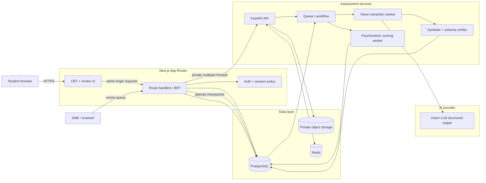
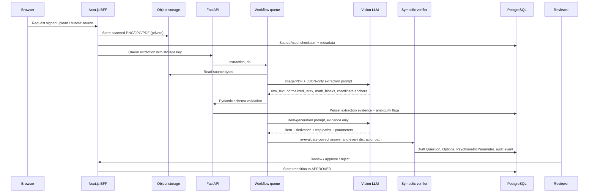

# TargetJEE Engine — Production System Architecture

## 1. Technology recommendation

| Concern | Recommended stack | Responsibility |
|---|---|---|
| Learner web app | **Next.js 15 App Router**, TypeScript, React 19 | CBT delivery, authenticated UI, server components for dashboards, route handlers/BFF boundary. |
| UI system | **Tailwind CSS** + CSS custom properties + accessible headless primitives | High-contrast NTA-like design tokens, responsive layouts, focus states, testable component variants. The reference UI currently uses portable CSS; production should migrate the same tokens to Tailwind config. |
| Mathematical typesetting | **KaTeX** | Client answer rendering and server review snapshots. All generated expressions are rendered with `throwOnError: false` during preview and rejected by a validation gate before publishing. |
| AI / extraction API | **Python 3.12, FastAPI, Pydantic v2** | Vision-LLM orchestration, strict structured-output validation, OCR/diagram normalization, symbolic-verification jobs. |
| Background work | Temporal or Celery/Arq with Redis/SQS | Asynchronous image/PDF extraction, Vision calls, symbolic validation, recalibration jobs; requests never wait on an LLM. |
| Database | **PostgreSQL 16** | Transactional source, item, option, attempt, timing, confidence and audit records. |
| Type-safe data access | **Prisma** from Next.js BFF | Sessions, immutable option permutations, student attempts, analytics reads, reviewer workflows. |
| Object storage | Private S3/R2/GCS bucket | Original PNG/JPG/PDF bytes, encrypted at rest; access through short-lived signed URLs only. |
| Vision-LLM | OpenAI-compatible structured-output provider behind a FastAPI adapter | Extract raw prose, mathematical regions, coordinate anchors and OCR ambiguity into the typed extraction contract. |
| Observability | OpenTelemetry + Sentry + structured JSON logs | Trace upload → extraction → validation → review; retain prompt hash, model version and content-review decision. |

---

## 2. Logical architecture



### Ownership boundaries

- **Browser:** presentation, KaTeX rendering, local timer display, optimistic status changes. It must not own model credentials, answer keys, official attempt duration, psychometric calibration, or final score authority.
- **Next.js BFF:** authentication, CSRF/origin checks, same-origin upload proxy, Prisma transactions, session bootstrap and learner/reviewer views.
- **FastAPI:** media validation, OCR/Vision adapter, Pydantic contracts, symbolic-validation job dispatch, model-response auditing.
- **Worker tier:** retryable, idempotent heavy tasks. Each job carries a source checksum or item version so duplicate uploads and retries cannot create duplicate questions.
- **PostgreSQL:** source-of-truth for delivery state and audit data. Object storage holds the binary source; the database stores only keys, checksum and structured evidence.

---

## 3. Source-to-item pipeline



### Required extraction result

FastAPI returns the `ExtractionResult` contract in `backend/app/extraction.py`:

```json
{
  "raw_text": "exact readable source prose",
  "normalized_latex": "\\text{...} \\frac{...}{...}",
  "math_blocks": ["\\int_0^\\pi f(x)\\,dx"],
  "classification": {
    "subject": "Mathematics",
    "chapter": "Integral Calculus",
    "topic": "Definite integrals and symmetry",
    "target_level": "JEE Advanced",
    "confidence": 0.94,
    "evidence": "Visible integral and reflection-symmetry notation"
  },
  "coordinate_diagram": {
    "description": "visible coordinate evidence only",
    "x_label": "x",
    "y_label": "y",
    "points": [{ "label": "P", "x": 42, "y": 64 }],
    "primitives": ["axis", "line", "label"]
  },
  "tags": ["Physics", "Rotational Motion"],
  "extraction_confidence": 0.94,
  "ambiguities": [],
  "source": "vision"
}
```

**Publication rule:** an ambiguity such as a cropped axis label, unreadable exponent or uncertain diagram point blocks automatic publication. It may be stored for a reviewer, but cannot become a live assessment item.

---

## 4. CBT delivery and scoring path

```mermaid
sequenceDiagram
  participant B as Browser CBT
  participant N as Next.js BFF
  participant P as PostgreSQL
  participant W as Scoring worker

  B->>N: Start drill
  N->>P: Create TestSession + lock question IDs and optionOrderJson
  P-->>N: Session blueprint
  N-->>B: Questions with session-specific option order
  B->>N: Checkpoint selected option, confidence, elapsed time
  N->>P: Upsert UserItemAttempt
  Note over B,N: Browser timer is display-only; server records checkpoints.
  B->>N: +1 / +2 minute extension
  N->>P: Create TimeDeficitEvent + update extensionMs
  B->>N: Submit session
  N->>P: Lock attempt records in one transaction
  N->>W: scoring job
  W->>P: 3PL theta, tau, Brier/ECE, pressure theta, distractor result
  W-->>N: Diagnostic-ready session
  N-->>B: Cognitive breakdown
```

### Delivery invariants

1. Generate the answer-option permutation **once** at `TestSession` creation using a cryptographically secure server random source. Persist it in `UserItemAttempt.optionOrderJson`; never reshuffle after any response is recorded.
2. The displayed timer may count down locally, but the API must calculate final elapsed time from monotonic server/checkpoint events. Treat client duration as advisory only.
3. At `00:00`, create no failure state. A `+1` or `+2` choice writes exactly one `TimeDeficitEvent` with `addedMs`, `budgetExhaustedAtMs`, and timestamp. The attempt remains eligible for diagnostics.
4. The scoring worker fits Van der Linden's precision-weighted log-time hierarchy, not a raw average: \(\ln(T_i) \sim \mathcal{N}(\beta_i-\tau, 1/\alpha_i^2)\). Its closed-form conditional MLE is \(\hat\tau=\sum_i\alpha_i^2(\beta_i-\ln T_i)/\sum_i\alpha_i^2\), with conditional standard error \(1/\sqrt{\sum_i\alpha_i^2}\).
5. The scoring worker computes the requested hasty-response penalty and the explicit time-deficit term before persisting `pressureTheta`:

\[
\theta^*(t,g) = \theta - \lambda\max(0,\beta_i/t - 1) - \delta\ln(1 + g/\beta_i)
\]

6. Every delivered item must have an explicit subjective-confidence report \(f_n \in [0,1]\) before the BFF can move the session to `SUBMITTED`; this includes an explicit `0` report for a skipped item. The submission transaction rejects a null `confidence` or `confidenceReportedAt`.
7. Final scoring, answer keys, confidence calibration, and IRT updates run only after the session is locked.

---

## 5. PostgreSQL / Prisma data responsibilities

| Prisma model | Purpose |
|---|---|
| `SourceAsset` | Source file checksum, private storage key, normalized extraction JSON and parse confidence. |
| `Question` | Versioned learner-facing stem, methods A/B, avoidance rule, approval lifecycle and immutable generation contract. |
| `PsychometricParameter` | 3PL `a/b/c`, log-time `beta`, time precision `alpha`, calibration metadata and sample count. |
| `QuestionOption` | Canonical answer value and original option identity; display position is session-specific. |
| `DistractorArchetype` | Symbolically evaluable misconception path, diagnosis, avoidance rule and NRM `a_ik/c_ik`. |
| `TestSession` | Locked drill blueprint and aggregate theta, tau, Brier/ECE results. |
| `UserItemAttempt` | Selected canonical option, immutable delivered option order, confidence, response duration and pressure result. |
| `TimeDeficitEvent` | One immutable row per `+1/+2` grace decision. |
| `CalibrationLog` / `AbilitySnapshot` | Longitudinal confidence and ability estimates. |
| `GenerationAuditEvent` | Model, prompt hash, validation decision and reviewer trace. |

---

## 6. API surface

| Route | Owner | Purpose |
|---|---|---|
| `POST /api/extractions` | Next.js | Same-origin broker; forwards multipart source to FastAPI without exposing an internal host. |
| `POST /v1/extractions` | FastAPI | Produces raw text, KaTeX-safe expressions and coordinate evidence from an image/PDF. |
| `POST /v1/sources` | FastAPI | Validates media metadata/checksum and queues a durable source workflow. |
| `POST /v1/items/validate` | FastAPI | Rejects malformed generated items before persistence. |
| `POST /v1/analytics/van-der-linden` | FastAPI | Server-authoritative fit of \(\tau\), standard error and log-likelihood for the hierarchical log-time model. |
| `POST /api/sessions` | Next.js BFF | Creates session blueprint and server-locks randomized option order. |
| `PATCH /api/attempts/:id` | Next.js BFF | Checkpoints selection, confidence and elapsed duration. |
| `POST /api/attempts/:id/time-deficits` | Next.js BFF | Transactionally creates a `TimeDeficitEvent`; only accepts allowed buffer amounts. |
| `POST /api/sessions/:id/submit` | Next.js BFF | Atomically locks attempts and starts scoring. |
| `GET /api/sessions/:id/diagnostic` | Next.js BFF | Returns item-level trap, SATO and calibration review after scoring. |

Implement the Next.js delivery routes with Zod/Valibot input contracts plus Prisma transactions; keep FastAPI contracts Pydantic-owned. This prevents schema drift without forcing Python to own learner-session writes.

---

## 7. Security, privacy and reliability

### Security controls

- Enforce authenticated user/session ownership on all BFF routes.
- Use short-lived signed object-storage URLs; never expose source bucket objects publicly.
- Verify MIME **and file signatures**, impose file/page/size limits, virus-scan before extraction, and reject malformed PDFs.
- Keep Vision provider keys and storage credentials in server-only environment variables. `NEXT_PUBLIC_*` must never contain an LLM key.
- Apply CSP, CSRF protection for cookie sessions, rate limits to uploads and LLM-triggering routes, and reviewer RBAC.
- Retain option permutation and model audit logs for scoring disputes; do not log raw source bytes in application logs.

### Reliability controls

- Use source `sha256` as an idempotency key for uploads/extraction.
- Queue jobs with retry policy, dead-letter queue and explicit source/item version.
- Use an outbox table or workflow signal when an item is approved or a session is submitted.
- Apply a circuit breaker around the Vision provider. On provider failure, preserve the source as `PENDING_REVIEW`; never invent extraction evidence.
- Cache static approved questions, but do not cache authenticated attempt writes or diagnostic output across users.

### Calibration safeguards

- Initial `a/b/c`, NRM and time parameters are expert priors, not claims of empirical calibration.
- Re-estimate parameters only after minimum sample thresholds and drift checks.
- Label theta and ECE as provisional for short tests; report standard error/test information when enough responses are available.
- Do not infer clinical or fixed cognitive traits from individual mistakes.

---

## 8. Deployment topology

```text
Internet
  └─ CDN / WAF
      └─ Next.js containers (App Router + BFF)
          ├─ PostgreSQL primary + read replica
          ├─ Redis / workflow broker
          ├─ private object storage
          └─ FastAPI containers
               └─ worker containers
                    ├─ Vision LLM provider
                    └─ symbolic verification runtime
```

- Deploy Next.js and FastAPI separately; autoscale the worker tier by queue depth, not HTTP request count.
- Run Postgres migrations as a one-shot deployment job before web/worker rollout.
- Use blue/green or canary releases for prompt/model changes; `GenerationAuditEvent.promptHash` makes output cohorts traceable.
- Keep all timestamps UTC in storage and localize only in the presentation layer.

---

## 9. Environment variables

```bash
# Next.js BFF
DATABASE_URL="postgresql://..."
TARGETJEE_API_BASE_URL="http://targetjee-api:8000"

# FastAPI / worker only
VISION_LLM_BASE_URL="https://provider.example/v1"
VISION_LLM_API_KEY="server-only-secret"
VISION_LLM_MODEL="vision-model-id"
OBJECT_STORAGE_BUCKET="targetjee-private"
REDIS_URL="redis://..."
```

The existing `.env.example` contains the local development subset. Production secrets belong in the deployment platform’s secret manager, not `.env` committed to source control.
